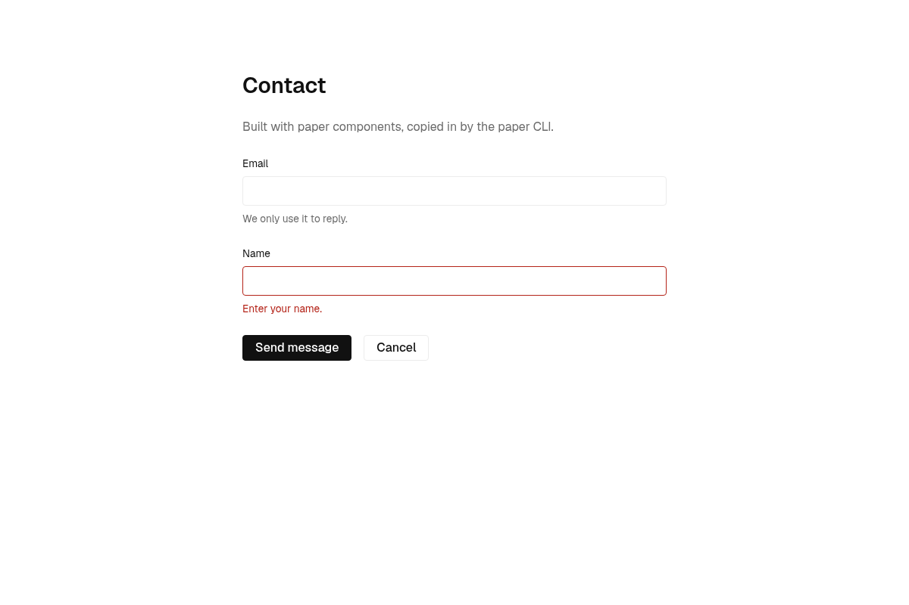

# agentproof-ui

A reference architecture for design systems that AI agents can use correctly.

Agents that write UI drift from the design system. They write raw hex colors, pass props that no longer exist, and rebuild a component by hand next to the real one. This repo shows one way to stop that, with working code you can read and fork. It is a set of decisions, each explained, and an example that implements them.

It is for teams that own a design system and want agents to use it, and for anyone building a CLI that agents call.

## The idea

- Each component has typed docs (`button.docs.ts`). The compiler fails if they mention a prop or an example that does not exist.
- A non-interactive CLI, `paper`, serves the docs, copies components into projects, and checks projects against the rules. Every command has `--json` and exit codes.
- Rules that code can check are checks (`paper check`), not prose.
- `paper init` writes a short, managed block into the project's `AGENTS.md` that tells agents to use the CLI.
- `pnpm generate` writes `registry.json`, `llms.txt`, and the token files. `pnpm check` fails when they are stale.

The example design system is `paper`: black on white, Geist, a 35rem column, styled with [StyleX](https://stylexjs.com). It has two components, `Button` and `Input`.



## Background

Two essays explain the reasoning:

- [The Agent Needs a Vocabulary](https://www.juanhander.com/the-agent-needs-a-vocabulary/): an agent has no team memory, so the design system is the vocabulary it builds with.
- [CLIs and Skills](https://www.juanhander.com/clis-and-skills/): use commands for procedures that can be specified exactly, and skills for decisions that need judgment. This is why `paper` is a CLI.

## Quick start

Requires Node 24 (LTS) and pnpm.

```sh
git clone https://github.com/handxr/agentproof-ui && cd agentproof-ui
pnpm install
pnpm check                      # types, lint, tests, generated files
pnpm --filter example build     # the demo app in apps/example
pnpm --filter example dev
```

Try the CLI from the example app:

```sh
cd apps/example
pnpm paper list
pnpm paper docs button
pnpm paper docs button --json
pnpm paper check
```

To build your own system on it, read [Forking](docs/forking.md).

## Docs

| Guide | Decision |
| --- | --- |
| [Project structure](docs/project-structure.md) | One workspace for tokens, components, the CLI, and generators |
| [Tokens](docs/tokens.md) | `tokens.json` as the only source, StyleX vars and CSS variables generated |
| [Components](docs/components.md) | One folder shape per component, enforced by a test |
| [Component docs](docs/component-docs.md) | Typed `docs.ts` instead of markdown, props from types |
| [A CLI for agents](docs/cli-for-agents.md) | A CLI instead of skills, with no prompts, `--json`, and exit codes |
| [Guardrails](docs/guardrails.md) | Rules as checks in `paper check` |
| [AGENTS.md block](docs/agents-md.md) | A managed, idempotent block written by `paper init` |
| [Generated files](docs/generated-files.md) | `registry.json`, `llms.txt`, staleness check |
| [Distribution](docs/distribution.md) | Copy code into the project, and point at a fork with `--registry` |
| [Forking](docs/forking.md) | What to change and what to keep |

For LLMs: [`llms.txt`](llms.txt) is the index and [`llms-full.txt`](llms-full.txt) has every component's docs and examples.

## Status

Early. The CLI is not on npm yet, so `npx paper` does not work. Run it from a clone with `node packages/cli/dist/paper.js` after `pnpm build:cli`, or through `pnpm paper` in `apps/example`. There is no docs website.

## Contributing

Read [AGENTS.md](AGENTS.md) and [ARCHITECTURE.md](ARCHITECTURE.md). `pnpm check` must pass before every commit.

## License

MIT
